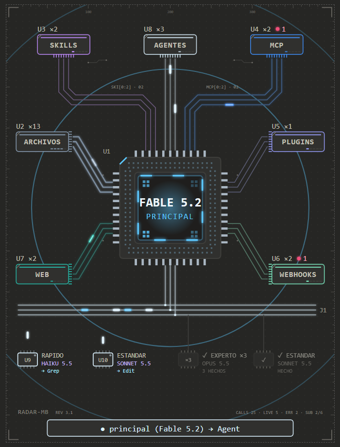

<p align="center"><a href="#english">English</a> | <a href="#espa%C3%B1ol">Español</a></p>

<a id="english"></a>

# Radar

## What it is

Radar is a sidebar pane for Claude Code that shows, live, what the session is doing: which agents are running, the task plan, every tool call, and the files read, edited or created. It is a Claude Code mod (function hooks) and opens by itself when a session starts.



*Rendered preview of the Placa view.*

## Features

Top box, `U0 · AGENTES`: an animated graph with two views, switched by a button.

- **Placa** (default): a motherboard. The main agent is the central CPU chip and shows its model. Seven peripheral chips stand for the kinds of tool use (Archivos, Skills, MCP, Plugins, Webhooks, Web, Agentes). Buses link them; a bus gets brighter the more it is used and carries animated light packets while calls run. Error LEDs show error counts. Subagents are smaller chips on an expansion bus: running ones are shown one by one with what they are doing, finished ones are grouped by type and model with ×N. A pulse expands from the CPU and speeds up with workload. A status strip shows the current call.
- **Radar**: the same data as a radar, with stations on rings.

Bottom box, three tabs with live badges:

- **TAREAS**: segmented plan progress bar, N/M and %, and the full task list (✓ done, ▶ current, ○ pending) with elapsed time on the current task.
- **PROCESOS**: live feed of tool calls with kind, agent, model and duration. Filters: "solo errores" and by agent. Press a row for full detail, including the complete command or path and the error text. "ir a lo último" jumps to the newest call.
- **ARCHIVOS**: tree of files read, edited and created, with `+A −D` changed lines per file. Press an edited file to see its diff.

Controls: fold either box, a button that cycles three height presets, scroll buttons. The palette is cold gray/blue, to match the Claude Code UI. The UI text is in Spanish.

## Install

```
/plugin marketplace add GITHUB_USER/REPO_NAME
/plugin install radar@MARKETPLACE_NAME
```

Then restart Claude Code.

## Usage

Radar opens automatically at session start. Run `/radar` to reopen it.

## Requirements and limits

- Claude Code mods (function hooks) are an **early access API**. It may change between releases and break this mod.
- Developed and checked on Windows with the Claude desktop app. In the terminal, the graph falls back to text.
- The feed keeps the last 120 calls.
- No data leaves your machine. The mod makes no network calls: searching the hooks for `fetch`, `$.net`, `$.http` and `$.model` finds nothing.
- The UI text is in Spanish.

## Development

From the repo root:

```
claude plugin validate radar
claude plugin test radar
```

## Support

If Radar is useful to you, you can buy me a coffee. Thanks.

[](https://ko-fi.com/zeuscolmenares)

## License

[MIT](LICENSE)

---

<a id="español"></a>

# Radar (Español)

## Qué es

Radar es un panel lateral para Claude Code que muestra en vivo qué hace la sesión: qué agentes corren, el plan de tareas, cada llamada a herramientas y los archivos leídos, editados o creados. Es un mod de Claude Code (hooks de función) y se abre solo al iniciar una sesión.


*Vista previa renderizada de la vista Placa.*

## Características

Caja superior, `U0 · AGENTES`: un grafo animado con dos vistas, que se cambian con un botón.

- **Placa** (por defecto): una placa base. El agente principal es el chip central (CPU) y muestra su modelo. Siete chips periféricos representan los tipos de uso de herramientas (Archivos, Skills, MCP, Plugins, Webhooks, Web, Agentes). Los buses los unen; un bus se ilumina más cuanto más se usa y lleva paquetes de luz animados mientras corren las llamadas. Los LED de error muestran el número de errores. Los subagentes son chips más pequeños en un bus de expansión: los que corren se muestran uno a uno con lo que hacen, los terminados se agrupan por tipo y modelo con ×N. Un pulso se expande desde la CPU y se acelera con la carga de trabajo. Una franja de estado muestra la llamada actual.
- **Radar**: los mismos datos como un radar, con estaciones en anillos.

Caja inferior, tres pestañas con contadores en vivo:

- **TAREAS**: barra de progreso del plan segmentada, N/M y %, y la lista completa de tareas (✓ hecha, ▶ actual, ○ pendiente) con el tiempo transcurrido de la actual.
- **PROCESOS**: feed en vivo de llamadas a herramientas con tipo, agente, modelo y duración. Filtros: "solo errores" y por agente. Pulsa una fila para ver el detalle completo, con el comando o ruta completos y el texto del error. "ir a lo último" salta a la llamada más reciente.
- **ARCHIVOS**: árbol de archivos leídos, editados y creados, con líneas cambiadas `+A −D` por archivo. Pulsa un archivo editado para ver su diff.

Controles: plegar cualquiera de las dos cajas, un botón que alterna tres alturas predefinidas, botones de scroll. La paleta es gris/azul frío, a juego con la interfaz de Claude Code. El texto de la interfaz está en español.

## Instalación

```
/plugin marketplace add GITHUB_USER/REPO_NAME
/plugin install radar@MARKETPLACE_NAME
```

Después reinicia Claude Code.

## Uso

Radar se abre solo al iniciar la sesión. Ejecuta `/radar` para reabrirlo.

## Requisitos y límites

- Los mods de Claude Code (hooks de función) son una **API de acceso anticipado**. Puede cambiar entre versiones y romper este mod.
- Desarrollado y comprobado en Windows con la app de escritorio de Claude. En la terminal, el grafo usa un texto alternativo.
- El feed guarda las últimas 120 llamadas.
- Ningún dato sale de tu máquina. El mod no hace llamadas de red: buscar `fetch`, `$.net`, `$.http` y `$.model` en los hooks no encuentra nada.
- El texto de la interfaz está en español.

## Desarrollo

Desde la raíz del repo:

```
claude plugin validate radar
claude plugin test radar
```

## Apoyo

Si Radar te resulta útil, puedes invitarme un café. Gracias.

[](https://ko-fi.com/zeuscolmenares)

## Licencia

[MIT](LICENSE)
